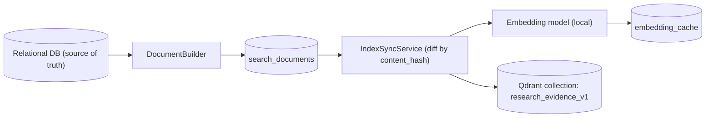
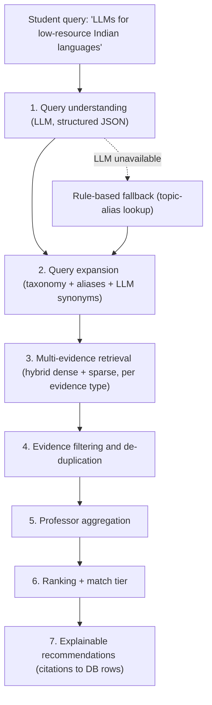

# Phase 2A — Multi-Evidence Professor Discovery Engine: Architecture Design

**Status:** Draft for review. Nothing in this document has been implemented yet.
**Scope:** IIT Kharagpur only, but the design is university-agnostic.
**Constraints honoured:** no frontend, no changes to faculty or publication records, no large-scale embedding run.

---

## 0. Findings that shape the design (please read first)

These figures were measured read-only against `data/processed/professor_discovery.db` on 2026-11-17.

| Evidence source | Coverage | Implication |
|---|---|---|
| Faculty records | 877 (842 verified, 31 needs_review, 2 pending, 2 rejected) | Rejected faculty are excluded from search. Needs-review faculty stay searchable but are flagged. |
| Official research interests | **790** faculty, about 128 characters on average | The broadest high-quality evidence. Short comma-separated phrase lists. |
| Biographies | **735** faculty, about 1,056 characters on average (max 4,312) | Long free text; needs chunking. Often restates the research interests. |
| Research projects | 7,760 projects; 789 faculty have at least one (786 have a `sponsored_research` project) | **Title only.** `description` holds only `Sponsor: …`. 3,025 projects are shared by more than one professor. |
| **Verified publications** | **84 links across only 13 faculty** | Tier 1 of your hierarchy is almost empty today. See decision D1. |
| Candidate publications (pending + needs_review) | 4,348 links across **672** faculty | This is where most publication evidence lives, but none of it is confirmed authorship. |
| Publication abstracts | 2,295 of 4,136 publications | Verified publications all have abstracts. |
| Normalized topics | 790 faculty have topic links; 6,495 canonical topics | Generic-root and noisy flags are available for down-weighting. |
| Department descriptions | **Not stored.** `departments` only has `name`, `code`, `academic_unit` | Department evidence can only be the department name, unless descriptions are collected later (D4). |
| Faculty with no evidence at all | **24** | They cannot be recommended for any topic. They are reported, not hidden. |
| Faculty whose only evidence is their department | 34 | They can surface only as weak contextual matches. |

> [!WARNING]
> **The live database is SQLite, not PostgreSQL.** `backend/database/connection.py` falls back to `sqlite:///data/processed/professor_discovery.db` because `DATABASE_URL` is not set. The design treats "the relational database" as the source of truth and works with both, but a PostgreSQL migration should come before production indexing (step 1 in §9).

> [!WARNING]
> **There are no Alembic migrations in the repository.** The Phase B and C columns (`original_title`, `project_category`, `canonical_topic_name`, and so on) were added with `ALTER TABLE` and exist only in the ORM models. A baseline Alembic revision is needed before the new tables in §2.4 are added.

---

## 1. Retrieval audit: where each evidence type comes from

| Evidence | ORM path | Filter rules |
|---|---|---|
| Biography | `Professor.biography` | Length over 10 characters. Exclude placeholder text. |
| Research interests | `Professor.research_interests` (+ `research_group` as context) | Length over 2 characters. |
| Verified publications | `Professor.professor_publications` → `ProfessorPublication.verification_status == 'verified'` → `.publication` (title, abstract, venue, year, DOI) | Link status, **not** `Publication.verification_status`, decides authorship. |
| Candidate publications | Same path with status `pending` or `needs_review` | Never labelled as authorship (see §5). |
| Projects | `Professor.professor_projects` → `ProfessorProject.role` → `.project` (title, sponsor, status, `project_category`) | Category is a ranking signal; nothing is excluded. |
| Topics | `Professor.topics` (M2M `professor_topics`) and `Publication.topics` → `ResearchTopic.canonical_topic_name`, `domain_name`, `area_name`, `is_generic_root`, `is_noisy_artifact` | Used for query expansion, payload filters and penalties. |
| Department | `Professor.department` → `Department.name`, `code`, `academic_unit`; `Department.university` | Weak context only. |

**No data-access layer exists yet.** All queries currently live inline in `backend/api/main.py`, and `backend/services/` only contains `reporting_service.py`. Phase 2A adds:

- a `DocumentBuilder` service, which reads the database and produces evidence documents;
- a `SearchService` with retrieval, aggregation and ranking;
- an `IndexSyncService` that keeps Qdrant consistent with the database.

---

## 2. Unified research document schema

### 2.1 Core schema (all evidence types)

| Field | Type | Notes |
|---|---|---|
| `document_id` | UUID | Deterministic UUIDv5 of `"{evidence_type}:{source_table}:{source_id}:{professor_id}:{chunk_index}"`. Re-running the builder produces the same IDs, so indexing is idempotent. |
| `professor_id` | int | Original `professors.id`. |
| `university_id` | int | Via department. Lets the search cover several universities later. |
| `department_id` | int | Original `departments.id`. |
| `evidence_type` | enum | `verified_publication`, `candidate_publication`, `research_interest`, `research_project`, `biography`, `department_context`. |
| `source_table` / `source_id` | str / int | For example `publications` / 323, or `research_projects` / 1254. Gives provenance back to the original row. |
| `link_id` | int, nullable | `professor_publications.id` or `professor_projects.id`. |
| `title` | str | Publication or project title, or `"Research interests — <name>"`. |
| `text_content` | str | The exact text that gets embedded (see §2.2). |
| `canonical_topics` | list[str] | From `ResearchTopic.canonical_topic_name`, excluding `is_noisy_artifact`. |
| `topic_domains` / `topic_areas` | list[str] | Tier 1 and Tier 2 of the taxonomy. |
| `source_url` | str | Profile URL, DOI or OpenAlex URL. |
| `verification_status` | str | The **link** status for publications. For other evidence, the professor's own status. |
| `confidence_score` | float | Link confidence for publications; 1.0 for official profile content. |
| `content_hash` | str | SHA-256 of `text_content`. Drives re-embedding and de-duplication. |
| `created_at` / `updated_at` | datetime | Document lifecycle timestamps, not source-row timestamps. |

### 2.2 Type-specific content and extra fields

| `evidence_type` | `text_content` template | Extra payload | Chunking |
|---|---|---|---|
| `verified_publication` | `{title}. {abstract}` | `doi`, `publication_year`, `venue`, `author_position`, `citation_count` | One chunk. Abstracts are short; if over 512 tokens, cut at a sentence boundary. |
| `candidate_publication` | Same | Same, plus `match_evidence` (`affiliation_evidence`) | Same |
| `research_interest` | `Research interests: {research_interests}. Research group: {research_group}` | `raw_phrases` (the split phrase list) | One document per professor, **plus** one short document per phrase (3–6 words each, for precise phrase matching). |
| `research_project` | `{title}. Sponsor: {sponsor}. Role: {role}. Status: {status}` | `project_category`, `role`, `sponsor`, `status`, `original_title` | One chunk (titles average 92 characters). |
| `biography` | Biography text | `chunk_index`, `chunk_count` | About 200-token chunks with 40-token overlap at sentence boundaries; about 2–6 chunks for an average biography. |
| `department_context` | `{department name} ({academic_unit})` | — | One per department, linked to all of its faculty at aggregation time (§6.2), not one copy per professor. |

### 2.3 Point granularity: one point per evidence-professor link

A publication with 3 IIT Kharagpur authors becomes **3 points that share one embedding**. The vector is computed once per `content_hash`; each point keeps its own `professor_id`, `link_id`, `verification_status` and `confidence_score`. Verification is per link (one co-author may be verified while another is pending), so a single shared point cannot represent it correctly.

Estimated number of points, which is small:

| Type | Points |
|---|---|
| Verified publication links | 84 |
| Candidate publication links | 4,348 |
| Project links | 12,801 |
| Research interests (summary + phrases) | 790 + about 4,000 |
| Biography chunks | about 2,500 |
| Department context | 65 |
| **Total** | **about 24,600 points, about 9,000 unique embeddings** |

### 2.4 New relational tables (source of truth for the index)

```text
search_documents        -- materialised evidence documents (§2.1 fields); Qdrant mirrors this table
index_sync_state        -- document_id, content_hash, embedding_model, indexed_at, qdrant_status
embedding_cache         -- content_hash, embedding_model, vector (BLOB) — avoids re-embedding unchanged text
```

`search_documents` is rebuilt from source tables by `DocumentBuilder`. It is a **derived** table: deleting it loses nothing that cannot be regenerated. **No existing table is modified**, apart from optionally adding `updated_at` columns (D5).

---

## 3. Qdrant design



| Decision | Recommendation | Reasoning |
|---|---|---|
| **Embedding model** | **`BAAI/bge-m3`** (dense 1024-d and sparse lexical weights in one model) | Strong on short scientific phrases and long text (up to 8k tokens). The sparse output gives exact-term matching for acronyms such as `CFD`, `VLSI` and `MOF` that dense models blur. Runs locally on CPU: about 9k texts takes roughly 20–40 minutes once, with no API cost or data leaving the machine. |
| Alternative | `BAAI/bge-base-en-v1.5` (768-d) plus Qdrant's built-in BM25 sparse model | About 3× faster and smaller, slightly weaker. A good fallback if bge-m3 is too slow on your hardware. |
| Vector dimensions | 1024 (dense) plus a sparse vector | Named vectors: `dense`, `sparse`. |
| Similarity metric | **Cosine** for dense; dot product for sparse (Qdrant's default for sparse vectors) | bge vectors are normalised. |
| Collection strategy | **One collection, `research_evidence_v1`**, with `evidence_type` as an indexed payload field | At 25k points, separate collections add fan-out cost without benefit. Per-type retrieval uses payload filters. The `_v1` suffix plus a Qdrant **alias** (`research_evidence`) allows a zero-downtime re-index when the model changes. |
| Payload indexes | `professor_id`, `department_id`, `university_id` (integer); `evidence_type`, `verification_status`, `project_category`, `topic_areas`, `topic_domains` (keyword); `confidence_score`, `publication_year` (float/integer) | Supports filters such as "verified only", "department X" or "exclude administrative projects", plus future country and university filters. |
| Payload contents | All §2.1 fields **except** long text: store `text_content` truncated to about 600 characters for explanations; full text stays in the database | Keeps Qdrant lean and keeps the database authoritative. |
| HNSW | Defaults (`m=16`, `ef_construct=100`), `ef=128` at query time | Exact enough at this scale. |
| Deployment | Qdrant in Docker locally (`qdrant/qdrant`), with persistent volume `data/qdrant/` | Requires a network or port step outside the sandbox when implemented. |

### 3.1 Incremental indexing and synchronisation

1. `DocumentBuilder` regenerates candidate documents from the database (fast, under a minute).
2. `IndexSyncService` compares them with `index_sync_state`:
   - **new document ID** → embed (or reuse a cached vector by `content_hash`) and upsert;
   - **same ID, changed hash** → re-embed and upsert;
   - **same ID, same hash, changed payload only** (for example a link moved from `pending` to `verified`) → `set_payload` only, with no re-embedding;
   - **ID no longer produced** (link rejected, project merged, professor rejected) → delete the point.
3. Status-driven rules: a publication link moving to `rejected` **removes** its point. A move from `pending` to `verified` changes `evidence_type` from `candidate_publication` to `verified_publication`, which produces a different document ID: delete the old point, insert the new one, and reuse the cached vector.
4. Triggers: run after the pipeline, after CSV review imports, and via an admin endpoint. Optional nightly full reconciliation. No database triggers are needed.
5. Model change: build `research_evidence_v2` in parallel, evaluate it, then switch the alias.

---

## 4. Search workflow



**Step 1: Query understanding.** An LLM returns JSON only: `core_concepts[]`, `methods[]`, `application_domains[]`, `excluded_concepts[]`, `geo_filter` (always IIT Kharagpur for now), `query_intent` (`broad` or `specific`). Recommended: Gemini 2.5 Flash, at temperature 0 with a JSON schema. **The LLM never names or invents professors**; it only rewrites the query. Fallback without an LLM: the alias and acronym map from `topic_normalization.py` plus taxonomy lookup.

**Step 2: Query expansion.**
- Map concepts to `canonical_topic_name` using exact, alias and embedding nearest neighbours over the canonical topic list. Add the Tier 2 `area_name` as a soft filter.
- Expand acronyms both ways (`NLP` ↔ `Natural Language Processing`).
- Produce **at most 5 sub-queries**: the original, plus one per core concept, plus one combined. Each expansion is labelled so that it gets less weight than the original query (§6).

**Step 3: Multi-evidence retrieval.** For each sub-query, run a Qdrant hybrid query (dense + sparse, fused with RRF), **separately per evidence type**, with a top-k quota per type:

| Evidence type | top-k per sub-query |
|---|---|
| `verified_publication` | 30 |
| `research_interest` | 60 |
| `research_project` | 80 |
| `biography` | 60 |
| `candidate_publication` | 60 |

Per-type quotas stop the 12.8k project points from crowding out the 790 interest documents. Filters: university, `professor.verification_status != rejected`, and `project_category != administrative_or_grant` by default.

**Step 4: Filtering and de-duplication** (§6.3).

**Steps 5–7:** §6.

Target latency: under 1.5 s without the LLM step (about 25 small Qdrant queries) and about 3 s with it. Query results are cached by normalised query.

---

## 5. Evidence hierarchy

| Rank | Evidence | Authorship and labelling rule |
|---|---|---|
| 1 | **Verified publications** (link status `verified`) | The only evidence that may be described as "authored". |
| 2 | **Official research interests** | Self-declared on the official IIT Kharagpur profile. |
| 3 | **Research projects** (`sponsored_research` > `industrial_consultancy` > `routine_testing_vetting`; `administrative_or_grant` excluded) | PI and Co-PI roles shown as recorded. |
| 4 | **Biographies** | Official profile text. |
| 5 | **Department specialisation** | Weak context. Can never by itself produce a "strong" or "related" match. |
| — | **Candidate publications** (pending / needs_review) | **Proposed separate, discounted category (D1).** Always labelled "possible publication — authorship not yet verified", never "authored by". |

**Eligibility without publications:** ranking uses whatever evidence exists. A professor with strong interest and project matches but no publications can rank first. The hierarchy changes **weights and explanation labels**, not eligibility.

---

## 6. Professor ranking methodology

### 6.1 Per-evidence relevance

For each retrieved point, `rel = fused_similarity` (RRF-fused dense + sparse, rescaled to 0–1 using the per-type score distribution from the evaluation set). Then apply:

- `× q_weight`: 1.0 for the original query, 0.8 for concept sub-queries, 0.6 for LLM-generated synonyms;
- `× topic_penalty`: 0.5 if the match is driven only by generic-root topics (`is_generic_root`, such as "Engineering" or "Computer science"); 0.7 if the document's topics are mostly `is_noisy_artifact`;
- `× quality`: `confidence_score` for candidate publications; a project-category factor for projects.

### 6.2 Aggregation per professor (avoids double counting)

Within each evidence type, take the professor's top matches with **diminishing returns**:

$$S_{type} = r_1 + 0.5\,r_2 + 0.25\,r_3 \quad (\text{top-3 only})$$

Then combine types with **hypothesis weights** (to be calibrated, §7):

$$S_{prof} = \sum_{t} w_t \cdot S_t \;+\; \beta \cdot \text{coverage\_bonus}$$

- Initial `w` hypotheses: verified publications 1.0, interests 0.9, projects 0.7, biography 0.5, candidate publications 0.4, department 0.15.
- `coverage_bonus` = number of **independent** evidence types with `rel` above a threshold (rewards corroboration across sources rather than volume within one).
- The department score is applied **once per professor**, and only when the query maps to a taxonomy area associated with that department.

### 6.3 De-duplication rules

1. **Same text, same professor**: points sharing a `content_hash` count once.
2. **Biography repeats interests**: if a biography chunk's best-matching sentence has cosine ≥ 0.92 with that professor's interest phrase that matched, the biography contribution is capped at 30%, so the professor is not rewarded twice for the same sentence.
3. **Duplicate projects**: project titles with ≥ 0.95 similarity under the same professor collapse to one (catches near-duplicates that survived Phase B).
4. **Shared items** (a co-authored publication or a multi-PI project): each professor gets credit, but projects where the professor is Co-PI are weighted 0.8 against 1.0 for PI.
5. **Candidate and verified versions of the same publication** cannot both count; verified wins.

### 6.4 Match tiers (shown to the student)

| Tier | Rule (thresholds calibrated in §7) |
|---|---|
| **Strong match** | At least one tier-1 or tier-2 item with `rel ≥ τ_high`, **and** corroboration from a second independent evidence type |
| **Related match** | `rel ≥ τ_mid` on any of tiers 1–4, or `τ_high` on one source without corroboration |
| **Weak contextual match** | Only biography or department matches, or only candidate-publication matches |
| **Insufficient evidence** | Professor is in a matching department or area but has no evidence document above `τ_low`. Listed separately, never mixed into the ranking. |

### 6.5 Explanation output (per professor)

Each recommendation cites database rows, with no free-form LLM claims about the professor:

```json
{
  "professor_id": 283, "name": "…", "department": "Computer Science and Engineering",
  "match_tier": "strong", "score": 2.41,
  "why": [
    {"evidence_type": "research_interest", "snippet": "…natural language processing, low-resource languages…", "source_url": "https://www.iitkgp.ac.in/department/CS/faculty/…"},
    {"evidence_type": "research_project", "title": "…", "role": "Principal Investigator", "sponsor": "MeitY", "project_id": 3590},
    {"evidence_type": "candidate_publication", "title": "…", "label": "Possible publication — authorship not yet verified", "link_id": 1234}
  ],
  "evidence_counts": {"verified_publication": 0, "research_interest": 1, "research_project": 3, "biography": 1}
}
```

An optional LLM step can turn the `why` list into a two-sentence summary, but only using the cited snippets. The prompt forbids adding facts.

---

## 7. Evaluation before fixing weights

The weights and thresholds above are **starting hypotheses only**. Before they are frozen:

1. **Query set:** about 30 queries covering broad (`machine learning`), specific (`spiking neural networks on FPGA`), acronym (`CFD of turbomachinery`), cross-disciplinary (`AI for agriculture`), humanities and law (`environmental law`), and rare topics. I'll draft it; **you or domain experts should review the relevance labels.**
2. **Labels:** for each query, label the pooled top-20 results (union across configurations) as 2 / 1 / 0.
3. **Metrics:**
   - nDCG@10 and Precision@5;
   - **no-publication recall**: the share of relevant professors without verified publications who appear in the top 10;
   - tier calibration: the percentage of "strong" results labelled 2.
4. **Ablations:**
   - evidence-type weight grid (coarse);
   - with and without candidate publications (D1);
   - dense only, sparse only and hybrid;
   - with and without query expansion;
   - with and without de-duplication rules.
5. **Freeze criteria:** the chosen configuration beats the publications-only baseline and the interests-only baseline on nDCG@10, without lowering no-publication recall.

---

## 8. Component layout (planned files)

```text
backend/search/
  document_builder.py      # DB → search_documents (no writes to source tables)
  embedding.py             # bge-m3 wrapper + embedding_cache
  qdrant_index.py          # collection/alias management, upsert/delete/set_payload
  index_sync.py            # diff + sync (§3.1)
  query_understanding.py   # LLM JSON + rule-based fallback
  retrieval.py             # hybrid per-type retrieval
  ranking.py               # §6 scoring, dedup, tiers, explanations
  evaluation/              # query set, labels, metrics runner
backend/api/search_routes.py   # GET /search/professors?q=… (JSON only, no UI)
alembic/                   # baseline + search tables
tests/test_search_*.py     # unit tests with an in-memory Qdrant (qdrant-client ":memory:" mode)
```

---

## 9. Implementation sequence

| Step | Work | Gate before next step |
|---|---|---|
| 1 | Alembic baseline of current schema; add `search_documents`, `index_sync_state`, `embedding_cache`. Optionally switch to PostgreSQL (D2). | Row counts identical before and after; 43 tests pass |
| 2 | `DocumentBuilder` + unit tests; build documents into the database (no embeddings yet) | Document counts match §2.3 estimates; provenance spot-check |
| 3 | Qdrant (Docker) + embedding wrapper; **pilot index of 3 departments** (for example CS, ME, BT, about 2.5k points) | Pilot retrieval sanity check on 10 queries |
| 4 | Retrieval + ranking + explanations against the pilot | Explanations cite correct rows |
| 5 | Evaluation set + ablations on the pilot; calibrate weights and thresholds | **Review checkpoint with you** |
| 6 | Full index (about 9k embeddings); incremental sync + deletion tests | Sync tests: verify, reject, merge, re-embed |
| 7 | `/search/professors` API endpoint + tests | Full evaluation on all departments |

---

## 10. Decisions needed from you

- **D1. Candidate publications in ranking.** With only 13 faculty having verified publications, excluding candidates removes publication evidence for about 660 faculty. I recommend **including them as a separate, discounted, clearly labelled evidence type** (as designed above), with the final weight decided by the evaluation in §7. The alternative is to exclude them entirely until more links are verified.
- **D2. PostgreSQL now or later.** The design works on SQLite for development. Migrating before step 1 avoids running the Alembic baseline twice.
- **D3. LLM provider for query understanding.** Gemini 2.5 Flash (recommended, needs an API key), a local model, or rule-based only for the first version.
- **D4. Department descriptions.** None are stored. Should department "About" pages be collected later as weak context? This would need new scraping, which needs your approval.
- **D5. `updated_at` columns** on `publications`, `research_projects` and `research_topics` (additive, nullable). They would make sync cheaper but are not required, because hash-diffing works without them.
- **D6. Embedding model.** `bge-m3` (recommended) or `bge-base-en-v1.5` with BM25 if CPU time is a concern.
